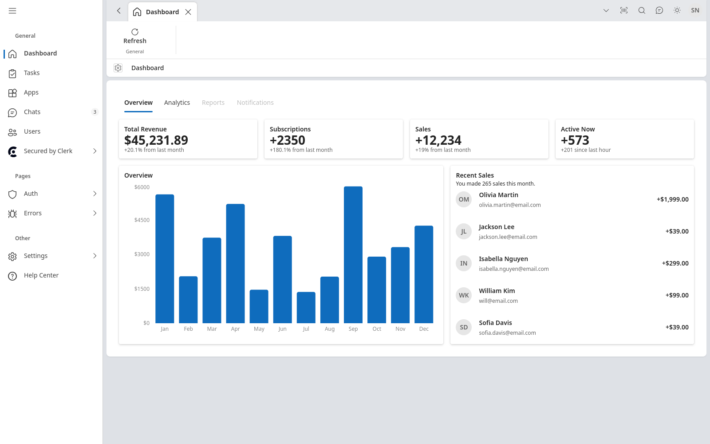

# Fluent Admin

Admin dashboard UI built with Fluent UI React v9 and Vite, with responsiveness and accessibility in mind.



This project was forked from the upstream shadcn-admin template.

## Features

- Light/dark mode
- Responsive layout
- Accessible components
- Navigation pane with collapse/expand
- Global search command
- 10+ pages
- RTL support

## UI components

All Fluent UI components used by the app are wrapped in `src/components/ui/` under their original names (Button, Card, Table, and so on), so a change in one wrapper applies everywhere the component is used. Fluent components are imported only from `@fluentui/react-components`, and icons only from `@fluentui/react-icons`. The wrappers are hand-maintained for this project; they are not generated or updated by any external component CLI.

## Tech Stack

**UI:** [Fluent UI](https://fluent2.microsoft.design/) (Fluent UI React v9)

**Build Tool:** [Vite](https://vitejs.dev/)

**Routing:** [TanStack Router](https://tanstack.com/router/latest)

**Type Checking:** [TypeScript](https://www.typescriptlang.org/)

**Linting/Formatting:** [ESLint](https://eslint.org/) & [Prettier](https://prettier.io/)

**Icons:** [Fluent UI Icons](https://react.fluentui.dev/), custom brand icons

**Auth (partial):** [Clerk](https://clerk.com/)

## Run Locally

Clone the project

```bash
  git clone https://github.com/iamraydoan/fluent-admin.git
```

Go to the project directory

```bash
  cd fluent-admin
```

Install dependencies

```bash
  pnpm install
```

Start the server

```bash
  pnpm run dev
```

Build for production

```bash
  pnpm run build
```

## Author

Maintained by [Ray Doan](https://github.com/iamraydoan).

## License

Licensed under the [MIT License](https://choosealicense.com/licenses/mit/)
